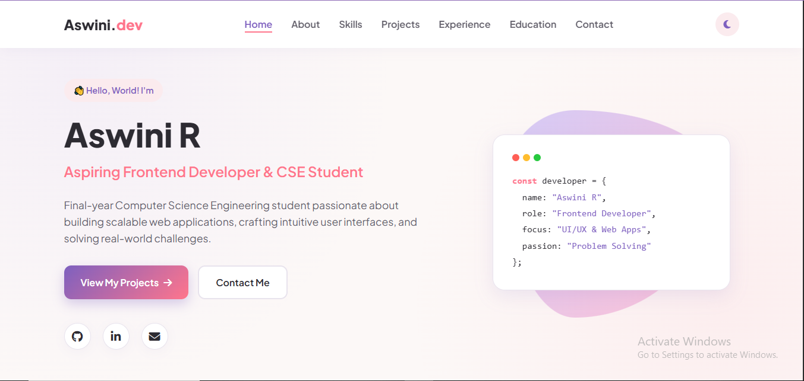
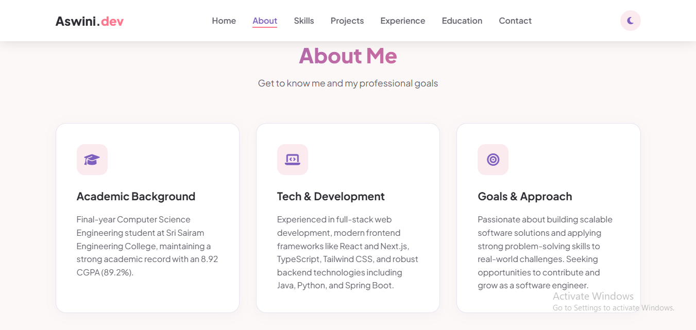
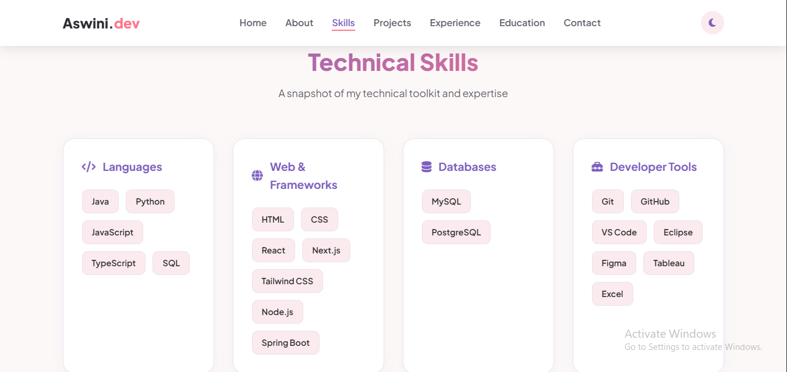
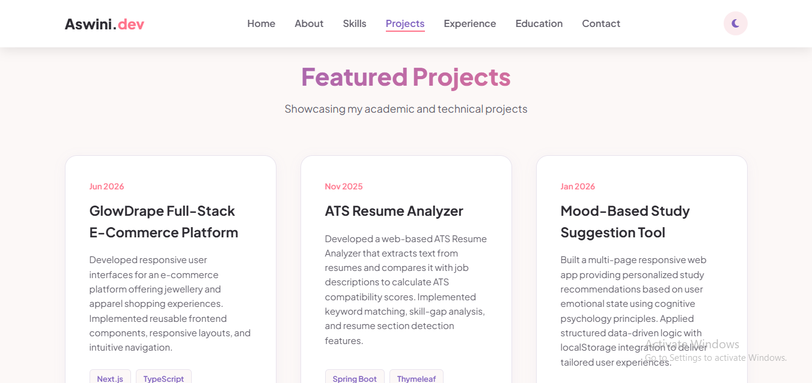
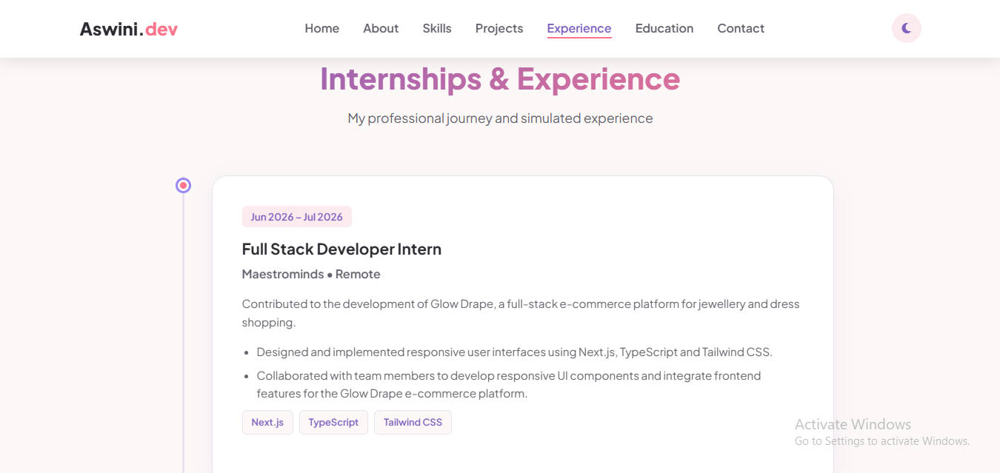
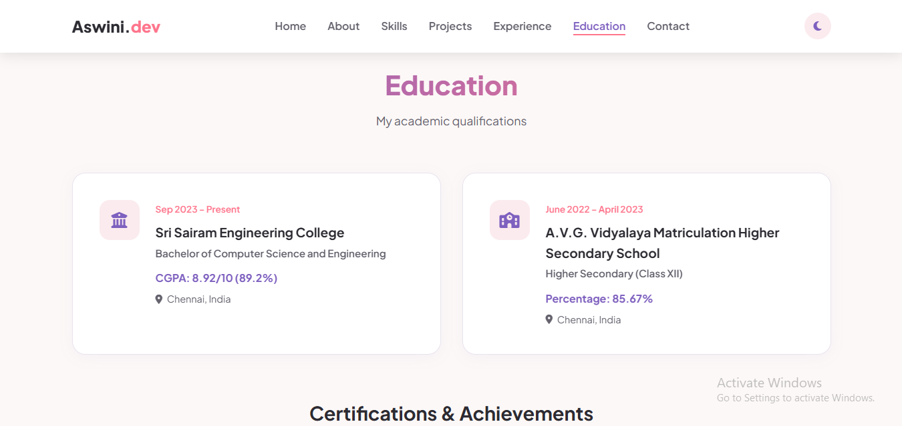
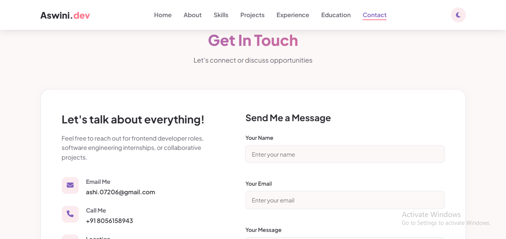

# Personal Portfolio Website

## Internship Details

- **Internship Organization:** CODTECH IT SOLUTIONS PRIVATE LIMITED
- **Domain:** Frontend Web Development
- **Intern ID:** CIS88
- **Full Name:** ASWINI R
- **Email:** ashi.07206@gmail.com
- **Duration:** 30 Days
- **Project Name:** Personal Portfolio Website

## Project Overview

The Personal Portfolio Website is a responsive website developed to showcase my professional profile, technical skills, educational background, projects, and internship experiences.

The main objective of this project is to create a professional online presence where visitors and recruiters can learn about my background, explore my work, and connect with me.

## Project Scope

This project focuses on designing and developing a modern, creative, and user-friendly personal portfolio website using frontend web development technologies.

It includes:
- A home section introducing myself.
- An About Me section describing my background.
- A Technical Skills section showcasing my skills.
- A Projects section displaying my work.
- An Experience section highlighting internship experiences.
- An Education section presenting my academic background.
- A Contact section providing ways to connect with me.

The website is designed to provide a smooth browsing experience across desktop, tablet, and mobile devices.

## Technologies Used

- **HTML5:** For creating the structure and content of the website.
- **CSS3:** For styling, layouts, animations, and responsive design.
- **JavaScript:** For interactive elements and dynamic functionality.

## Features

- Modern and creative user interface.
- Responsive layout for different screen sizes.
- Interactive navigation bar.
- Smooth scrolling between sections.
- Animated elements and hover effects.
- Project showcase cards.
- Contact form with input validation.
- User-friendly interface.

## Project Structure

```text
personal-portfolio/
│
├── index.html
├── style.css
├── script.js
└── README.md
```

## How to Run the Project

1. Clone or download this repository.
2. Open the project folder.
3. Open `index.html` in a web browser.
4. Explore the portfolio website.

Alternatively, open the folder in Visual Studio Code and use the Live Server extension.

## Screenshots

Screenshots of the completed website will be included in this repository to demonstrate the project output.

### Home


### About


### Skills


### Projects


### Experience


### Education


### Contact


## Conclusion

This project helped me apply my knowledge of HTML, CSS, and JavaScript to develop a responsive and interactive personal portfolio website. It also provided practical experience in frontend development, website design, and creating user-friendly interfaces.

---

**Developed as part of the CODTECH IT SOLUTIONS Internship Program.**
